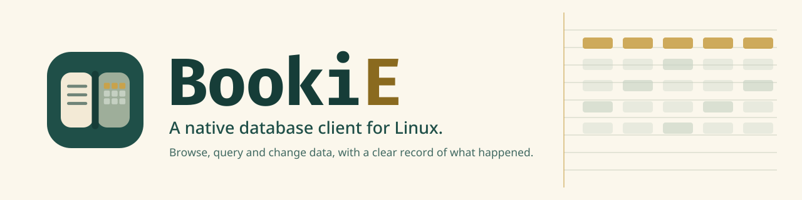
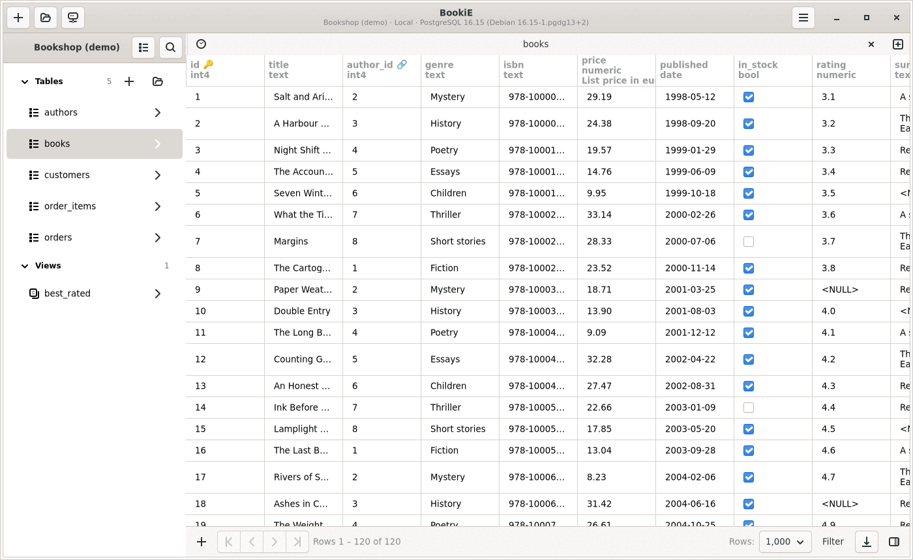
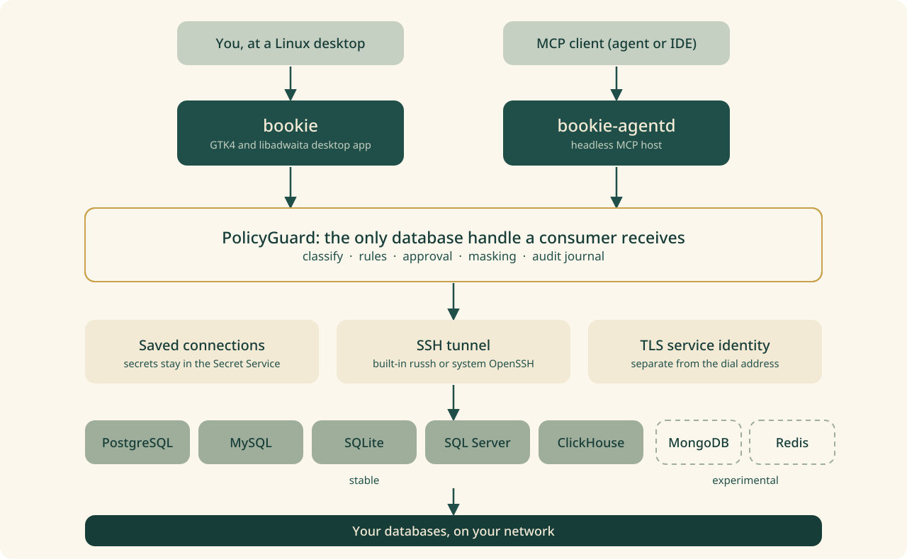

<p align="center">
  <picture>
    <source media="(prefers-color-scheme: dark)" srcset="docs/brand/banner-dark.svg">
    
  </picture>
</p>

BookiE is a free, open-source database client for Linux, built for data analysts, database administrators, and developers. Browse tables, write SQL, investigate results, and review changes in a native desktop workspace.

<p align="center">
  <picture>
    <source media="(prefers-color-scheme: dark)" srcset="docs/images/browse-dark.png">
    
  </picture>
</p>

## At a glance

| | |
|---|---|
| Platform | Linux, with a native GTK4 and libadwaita interface. |
| Databases | PostgreSQL, MySQL and MariaDB, SQLite, SQL Server and ClickHouse. MongoDB and Redis are experimental. See the [driver maturity table](docs/adding-drivers.md#driver-maturity). |
| Cost | Every shipped feature is free, with no account, license key, subscription or paid tier. |
| Credentials | Kept in the desktop keyring (Secret Service). |
| Safety | Every statement is checked before it runs, and governed operations are recorded in a local audit journal. |
| AI agents | Optional Model Context Protocol access through the same checks. |
| License | [GNU Affero General Public License v3.0 or later](LICENSE). |

## Install

Each release lists a Debian package, an Arch package, a Flatpak bundle and an AppImage on the [release page](https://github.com/cozyGarage/BookiE/releases), with a `SHA256SUMS` file. The Debian and Arch packages are the main install paths. Library requirements and install acceptance are in [platforms](docs/platforms.md).

The AppImage is for trying BookiE without installing it. It does not bundle the GtkSourceView data, so on a system that lacks it the SQL editor has no syntax highlighting ([#1325](https://github.com/cozyGarage/BookiE/issues/1325)).

To build from source, see [Build and run](#build-and-run).

## First steps

1. Click the `+` in the window header, choose the database type and fill in the connection.
2. Click **Test**, then **Connect**.
3. Click a table in the sidebar to browse it, or press Ctrl+E to open a SQL editor.

The [user guide](docs/user-guide.md) has the full walk-through and the keyboard shortcuts. The [feature list](docs/features.md) shows what BookiE can do, with screenshots.

## Why BookiE?

The name grew out of watching *Peaky Blinders* and thinking about the bookies keeping their ledgers: recording entries, looking them up, and keeping track of changes. There is something familiar in that work for anyone who spends a day with `INSERT`, `SELECT`, `UPDATE`, and `DELETE`.

BookiE is for the people doing that work today. Its purpose is to help you understand your data, maintain your databases, and make deliberate changes with a clear record of what happened.

Open source made this project possible. BookiE grew from TablePro's Linux work and draws inspiration from the wider open-source database community. Building it is a way to give back through useful software, fixes, tests, documentation, and shared lessons. Contributions and credit belong alongside the code.

Every shipped feature is free to use, with no account, license key, subscription, paid tier, or remote entitlement check.

## Status

BookiE 0.2.0 was published on 2026-10-23. Subsequent development and 0.2.1 planning follow the [backlog](docs/backlog.md). Workflows include saved connections, SSH tunnels, browse and SQL tabs, structure editing, inline row changes, query history, policy checks, audit records, MCP access, and the headless `bookie-agentd` process. Table browsing fetches bounded pages from the database. Supported single-statement PostgreSQL `SELECT`s stream through a four-page window; other engines and query shapes keep their existing result caps. Broader streamed-result memory acceptance is tracked under PERF-2/PERF-8 ([ADR 0011](docs/decisions/0011-paged-query-results.md)).

PostgreSQL has the broadest release-fixture coverage: server-confirmed cancellation, certificate hostname and authority verification, verified TLS through an SSH tunnel, read-only denial, rollback, blocking-lock reporting, and reconnect run as deterministic container checks. MySQL, SQL Server, ClickHouse, Redis, and MongoDB also have driver TLS fixture evidence; those fixtures do not establish full transport or packaging readiness. Published artifacts and source-specific package evidence remain distinct from the maintainer's delivery-completion decision. The [documentation map](docs/README.md) links to current milestone status and the detailed acceptance boards.

See the [driver maturity table](docs/adding-drivers.md#driver-maturity) for current per-engine capabilities and limits, and [platforms](docs/platforms.md) for released packages, library requirements and install acceptance. The 0.1.5 packages do not qualify the 0.2.0 source.

## Supported platforms

BookiE targets Linux. The current 0.2.0 desktop target and package requirements are documented in [platforms](docs/platforms.md).

## Architecture



Every database handle that the desktop app, the MCP tools and `bookie-agentd` receive is a `PolicyGuard`. Token scopes and connection allowlists do not replace it. Drivers are linked at build time and the interface is native GTK, with no embedded browser. The desktop app uses `tablepro-app-services` for GTK-free application state and service logic.

[`ARCHITECTURE.md`](ARCHITECTURE.md) has the crate map, the request pipeline, trait boundaries and deliberate limits.

## Development

The product repository is [`cozyGarage/BookiE`](https://github.com/cozyGarage/BookiE), and current development is on the `linux` branch. BookiE is built with Rust, GTK4, libadwaita, GtkSourceView, and Relm4. The Cargo workspace lives at the repository root (`crates/`, `apps/linux/`, `tests/`, `scripts/`, `docs/`) and requires Rust 1.98.

Start with the [documentation map](docs/README.md) and [completion and continuation](docs/bookie-0.2-sprint.md) for current scope and evidence. Release publication remains a separate decision.

### Compatibility names

The product name is BookiE. Installed commands are `bookie` and `bookie-agentd`, with `tablepro*` aliases for compatibility. Existing installations keep their settings and credentials: app ID, configuration and data paths, keyring schema, UUIDs, audit format, and protocol contracts retain their existing `tablepro` / `com.tablepro.linux` identifiers. Cargo packages and binaries remain `tablepro-app` / `tablepro-agentd`, and crate names remain `tablepro-*`.


## Build requirements

```bash
# Debian testing
sudo apt install -y build-essential pkg-config libgtk-4-dev libadwaita-1-dev \
  libgtksourceview-5-dev libssl-dev libsecret-1-dev libkrb5-dev libsqlite3-dev clang

# Fedora (build from source)
sudo dnf install -y gcc pkg-config gtk4-devel libadwaita-devel \
  gtksourceview5-devel openssl-devel libsecret-devel krb5-devel clang

# Arch
sudo pacman -S --needed base-devel pkg-config gtk4 libadwaita \
  gtksourceview5 openssl libsecret krb5 sqlite clang
```

BookiE needs GTK 4.24, libadwaita 1.10 and GtkSourceView 5.22 or newer ([ADR 0021](docs/decisions/0021-toolkit-floor.md)): Arch Linux or Debian testing. Ubuntu and Debian stable releases ship older libraries.

Check the native libraries and Rust toolchain:

```bash
pkg-config --modversion gtk4 libadwaita-1 gtksourceview-5
rustc --version
```

## Build and run

From the repository root:

```bash
cargo run -p tablepro-app
```

Optional DuckDB driver:

```bash
cargo run -p tablepro-app --features duckdb
```

A plain `cargo run` shares settings, saved connections, the keyring entries and the single-instance lock with an installed BookiE. To keep test data apart, build with the development profile, which uses `~/.config/tablepro-devel` and its own keyring schema:

```bash
TABLEPRO_PROFILE=development cargo run -p tablepro-app
```

Starting a second copy of the same profile asks the running one to show its window and then exits.

### SQL Server Kerberos

Run `kinit` before connecting and confirm the ticket with `klist`. Select **Windows (Kerberos)** in the SQL Server connection form and enter the server's real DNS hostname. SQL Server requests `MSSQLSvc/<host>:<port>`, including when SSH forwards the socket through localhost.

A FILE credential cache works when `KRB5CCNAME` points to a readable location. Custom SPN overrides and cross-realm setup are not exposed in the connection form.

## Validate

Local cheap checks from the repository root:

```bash
bash scripts/preflight.sh
```

`preflight.sh` covers size and panic guards, formatting, Clippy, unit tests on non-GTK crates (it skips `tablepro-app`) and the sandbox tier. It does not run the installed GTK suite. Deeper layers (Docker drivers, GTK widgets, installed GTK, release fixture) are documented in [`docs/validation-playbook.md`](docs/validation-playbook.md) and [`docs/testing.md`](docs/testing.md).

From the repository root:

```bash
./scripts/smoke-postgres.sh          # optional smoke against a local PostgreSQL
./scripts/test-postgres-socket.sh    # disposable Unix-socket fixture
```

For manual connection checks across every network driver, use the local-only [manual connection fixture](tests/manual-connections/README.md).

If native development packages are unavailable, `scripts/dev-env.sh` can use Debian-family package payloads extracted under `.local-deps/root/`.

GitHub runs the cheap tier only; merge acceptance is the Forgejo gate (`bash scripts/forgejo-gate.sh <branch>`). Details: [AGENTS.md](AGENTS.md) and the [validation playbook](docs/validation-playbook.md#ci-tiers).

## Packaging

See the [packaging guide](apps/linux/packaging/README.md) for candidate builds and validation, and [platforms](docs/platforms.md) for release artifacts and package support.

## Documentation

Start at [the documentation map](docs/README.md) for audience and ownership. Common entry points:

| Topic | File |
|---|---|
| Product / personas / principles | [PRODUCT.md](PRODUCT.md), [docs/personas.md](docs/personas.md), [PRINCIPLES.md](PRINCIPLES.md) |
| Capability specs (drafts) | [specs/](specs/README.md) |
| Active sprint | [docs/bookie-0.2-sprint.md](docs/bookie-0.2-sprint.md) |
| Architecture | [ARCHITECTURE.md](ARCHITECTURE.md) |
| User guide | [docs/user-guide.md](docs/user-guide.md) |
| Feature list with screenshots | [docs/features.md](docs/features.md) |
| Brand: logo, colours, screenshots | [docs/brand/README.md](docs/brand/README.md) |
| Contributing / agent rules | [CONTRIBUTING.md](CONTRIBUTING.md), [AGENTS.md](AGENTS.md) |
| Changelog | [CHANGELOG.md](CHANGELOG.md) |

## Contributing

Read [`CONTRIBUTING.md`](CONTRIBUTING.md) and the rules in [`AGENTS.md`](AGENTS.md). Pull requests for current development target the `linux` branch and are accepted on a green Forgejo gate run.

## Changelog

Release notes and unreleased changes are in [`CHANGELOG.md`](CHANGELOG.md).

## License

BookiE is licensed under the [GNU Affero General Public License v3.0 or later](LICENSE).
