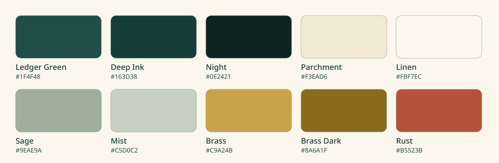

# BookiE brand

This page defines how the BookiE name, mark and colours are used in the repository, release pages and documentation. It covers visual identity only. Product scope is in [PRODUCT.md](../../PRODUCT.md).

## Concept

The name comes from a bookie's ledger: entries recorded, looked up and kept track of ([README](../../README.md#why-bookie)). The mark is an open ledger. The left page holds ruled lines and the right page holds a grid of cells. The top row of the grid is brass, like a column header. The tile is Ledger Green.

The wordmark is written `BookiE`. The final capital E is set in brass.

## Files

| File | Use |
|---|---|
| [`bookie-mark.svg`](bookie-mark.svg), [`bookie-mark-512.png`](bookie-mark-512.png) | App icon, avatars, favicons. |
| [`bookie-logo.svg`](bookie-logo.svg) | Mark with wordmark on light backgrounds. |
| [`bookie-logo-dark.svg`](bookie-logo-dark.svg) | Mark with wordmark on dark backgrounds. |
| [`banner-light.svg`](banner-light.svg), [`banner-dark.svg`](banner-dark.svg) | README header, 1280 by 320. |
| [`social-card.svg`](social-card.svg), [`social-card.png`](social-card.png) | GitHub social preview, 1280 by 640. Upload the PNG in the repository settings. |
| [`palette.svg`](palette.svg) | The colours below as swatches. |

All files are vector, except the two PNG exports. Text in every SVG is converted to outlines, so the files look the same without any font installed.

The packaged application icon (`apps/linux/flatpak/icons/scalable/com.tablepro.linux.svg`) is the same mark. It keeps the file name, because the app id and the Flatpak, Debian and Arch packages refer to it by that name. It renders identically to `bookie-mark.svg`, which carries a title and description for use on the web.

## Colours

| Name | Hex | Use |
|---|---|---|
| Ledger Green | `#1F4F48` | Primary. The tile, headings on light backgrounds. |
| Deep Ink | `#163D38` | Text on light backgrounds, the spine of the mark. |
| Night | `#0E2421` | Dark backgrounds. |
| Parchment | `#F3EAD6` | The left page, text on dark backgrounds. |
| Linen | `#FBF7EC` | Light backgrounds. |
| Sage | `#9EAE9A` | The right page, secondary shapes, rules. |
| Mist | `#C5D0C2` | Secondary text on dark backgrounds, cells. |
| Brass | `#C9A24B` | Accent on dark backgrounds, the header row of the mark. |
| Brass Dark | `#8A6A1F` | The same accent as text on light backgrounds. |
| Rust | `#B5523B` | Destructive actions and errors only. |

Measured contrast ratios (WCAG relative luminance):

| Pair | Ratio | Use for text |
|---|---|---|
| Deep Ink on Linen | 11.2 to 1 | yes |
| Ledger Green on Linen | 8.6 to 1 | yes |
| Brass Dark on Linen | 4.7 to 1 | yes, normal size |
| Rust on Linen | 4.6 to 1 | yes, normal size |
| Parchment on Night | 13.6 to 1 | yes |
| Mist on Night | 10.2 to 1 | yes |
| Sage on Night | 6.9 to 1 | yes |
| Brass on Night | 6.8 to 1 | yes |
| Brass on Linen | 2.2 to 1 | no, decoration only |

Do not put Brass on a light background as text. Use Brass Dark.

## Logo use

- Keep clear space of half the mark's width on every side.
- Do not use the mark smaller than 16 pixels. Below 32 pixels, use the mark without the wordmark.
- Do not stretch, rotate, recolour or add effects. Use the light or dark logo, not a different colour.
- On photographs or busy backgrounds, place the tile mark on a plain area.
- Write the name `BookiE` in running text, with a capital B and a capital E.

## Type

The wordmark is Fira Code Bold. Taglines are Noto Sans. Both are licensed under the SIL Open Font License 1.1, which allows embedding outlines in logos. Documentation uses the reader's own fonts.

## Voice

Descriptions are short, plain and specific. They say what BookiE does and what it does not. They do not use promotional adjectives. The [writing style](../../AGENTS.md#writing-style) in AGENTS.md applies to all public text, including banners and release pages.

## Screenshots

Screenshots in [`docs/images/`](../images/) show real windows from the 0.2.0 AppImage, running on a throw-away demo database of a fictional bookshop (invented authors and titles). Take new screenshots at 1400 by 860, in light and dark, with synthetic data only. Never include real hostnames, credentials or customer data.
