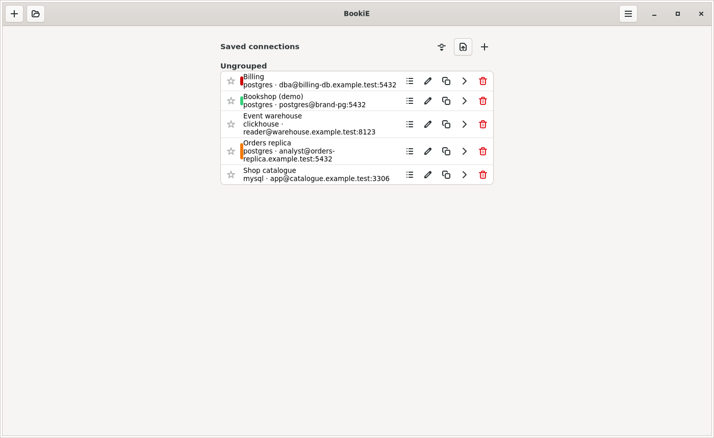
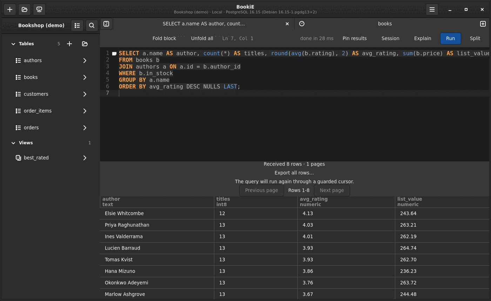
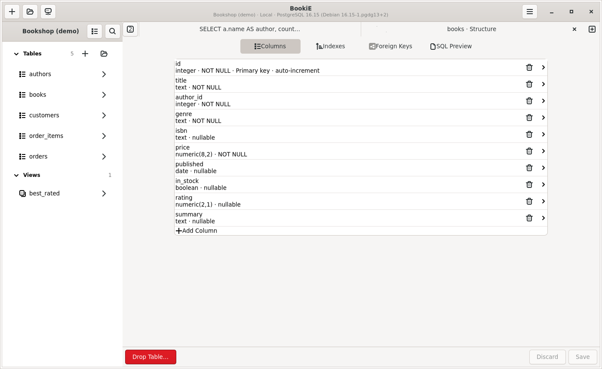

# BookiE features

This page lists what BookiE 0.2.0 does, grouped by task. Steps and shortcuts are in the [user guide](user-guide.md). Limits are in [known limitations](known-limitations.md). Per-engine capabilities are in the [driver maturity table](adding-drivers.md#driver-maturity).

## Databases

| Engine | Maturity | Notes |
|---|---|---|
| PostgreSQL | Stable | Broadest test coverage, including server-confirmed cancellation and verified TLS through SSH. |
| MySQL and MariaDB | Stable | Unix socket connections are supported. |
| SQLite | Stable | File based. |
| SQL Server | Stable | Kerberos sign-in is available. |
| ClickHouse | Stable | Mutations are awaited, so saved edits show up in the grid. |
| MongoDB | Experimental | Collections, find and aggregate. An optional authentication database can be set. |
| Redis | Experimental | One host and port. Sentinel and Cluster are not supported. |
| DuckDB | Experimental | Only in builds made with `--features duckdb`. Not in the released packages. |

Drivers are linked at build time. There is no plugin system ([ADR 0001](decisions/0001-no-plugin-system.md)).

## Connect

- Saved connections keep passwords in the desktop keyring (Secret Service), not in BookiE's own files.
- SSH tunnels use the built-in client or the system OpenSSH. BookiE asks before trusting an unknown host key.
- TLS has several strictness levels, up to checking both the certificate authority and the host name.
- Each connection has an environment: Local, Dev, Staging or Prod. A Prod connection shows a red badge, a tinted header and `[Production]` in the window title.
- A read-only connection refuses every change.
- A connection can be filled from a URL such as `postgres://user@host:5432/db`.
- Connections can be exported and imported. An export encrypted with a passphrase includes stored credentials. A plaintext export contains none.

## Browse and edit tables

- Click a table to open it in a preview tab. Edit or keep the tab to make it permanent.
- Tables are read in bounded pages. Tables with a primary key use keyset seeks for the previous page and the last page.
- Edit a cell with a double-click, F2 or Enter. Edits stay pending, with a dot on the tab, until Ctrl+S. Undo and redo apply to pending edits.
- Insert rows, delete rows and set a cell to NULL. Changes are saved in one transaction where the engine supports it.
- NULL, empty text and unsupported values look different. Booleans show a check box with a third state for NULL.
- The header shows each column's type. Primary key columns have a key mark, foreign key columns a link mark, and a column comment appears under the name.
- Filter with the filter bar, and save filters by name per table. Sort by clicking a header.
- Hide and reorder columns, and reset dragged column widths. The choice is remembered per table.
- Long values show a preview and their size. View Value, Copy Value and Edit Full Value work on the whole value.
- The row inspector shows every column of the selected row. Selection statistics show count, sum, average, minimum and maximum.

## Write SQL

- Ctrl+E opens an editor tab. Ctrl+Enter runs the selected text, or the whole script when nothing is selected. Ctrl+Shift+Enter runs the statement at the cursor. Escape cancels a running query when the server supports it.
- Syntax highlighting, code folding and a side-by-side split of the same query.
- Completion offers keywords, tables after `FROM` and `JOIN`, and the columns of the tables named in the statement. `alias.` and `table.` narrow the list. Chosen names are inserted quoted for the engine.
- Write `:name` where a value belongs. BookiE asks for each value and sends it as a bound parameter. Each value has a type choice: `Auto`, `Text`, `Integer`, `Decimal`, `Boolean` or `Null`. Placeholders inside string literals, quoted identifiers, comments, dollar-quoted bodies, PostgreSQL `::` casts and existing `$1` or `?` placeholders are left alone.
- Results load in pages. PostgreSQL single-statement `SELECT` queries stream through a window of four pages. Each statement in a script has its own result view. Pin results to keep them above the next run.
- Sorting and filtering a result are local and do not run the SQL again.
- Session keeps one connection for the tab, so settings, temporary tables and transactions carry over. While a transaction is open the button says so and, after a minute, how long it has been open.
- Explain shows the plan. PostgreSQL and SQLite plans open as a tree with the share of estimated cost per step.
- A query that hits the timeout offers Run again with a longer timeout, once, without changing the saved timeout.
- Query history opens in a panel under the workspace. Statements that set a password or key are not saved.
- Favorites: Ctrl+D saves the current query under a name in `$XDG_CONFIG_HOME/tablepro/favorites.json`. Saving an existing name replaces its statement.
- Open Quickly: Ctrl+P searches favorites, open tabs and saved connections.

## Tables and structure

The sidebar table menu has Edit Structure, Show CREATE TABLE, Import CSV, Rename Table, Truncate Table and Drop Table.

- Edit Structure has tabs for columns, indexes and foreign keys, and an SQL Preview tab.
- Rename Table is refused while the table has open tabs, so no pending change is lost.
- Truncate Table asks for confirmation and runs through the same guard as every other statement. SQLite does not support it.

## Import and export

- Export a table page or a query result as CSV, JSON, Markdown, HTML, XML, SQL or an Excel workbook.
- CSV export can protect cells that start like formulas, and can keep plain numbers unprotected so they import back into numeric columns.
- Import CSV into an existing table, or create a new table from a CSV file. Separator, header row and column mapping are detected and can be changed. The quote character, backslash escaping and file encoding (UTF-8, Windows-1252, UTF-16) can be set.
- Import accepts Excel `.xlsx` files. The first worksheet with data is read.
- Mappings can be remembered per connection and table.

## Safety and records

- Every statement is checked before it runs. Writes on a read-only connection are refused.
- Depending on the environment and policy, risky statements ask for approval first.
- Governed operations are written to a local audit journal. Denied, failed, cancelled and timed-out work still gets a recorded outcome.
- Values are never silently changed. An unsupported value stays visible as unsupported ([ADR 0007](decisions/0007-type-and-value-preservation.md)).

## PostgreSQL backup and restore

Back Up Database and Restore from Backup in the app menu use the installed `pg_dump` and `pg_restore`. They use the connection's configured SSH and TLS route. Restore requires a writable connection and approval, and both operations are audited.

## AI agents (MCP)

BookiE can let an AI assistant use saved connections through the Model Context Protocol. A token is created in Preferences, and limits which connections and which tools it may use. Every MCP request goes through the same policy guard as the desktop app. The headless `bookie-agentd` process serves MCP without a window. Data responses use a tagged value format that keeps wide integers exact ([user guide](user-guide.md#ai-agents-mcp)).

## What BookiE does not include

- No account, hosted service or paid tier.
- No browser interface and no runtime driver plugins.
- No database snapshots. The design is accepted in [ADR 0015](decisions/0015-database-snapshots.md) and the work is planned after 0.2.0.
- Linux only ([platforms](platforms.md)).

## Workspace controls

- The Run menu exposes whole-script and current-statement execution, with shortcuts, plus labeled export choices for individual loaded result sets or a guarded stream rerun.
- Owned editor sessions show transaction state and commit/rollback-and-close controls. Shared-connection transaction refusal and audit rules still apply.
- The header **Tables sidebar** button shows or hides the tables sidebar at every width. Wide windows dock it with a native resize divider; below 960 px it becomes an overlay that stays closed after connection. Tables expand for bounded field/type previews.
- Grid headers retain exact engine type case. Their native details menu exposes key, nullability and comment metadata.
- Export presents data scope before format and keeps unqualified full-table snapshot export unavailable.

Behavior and limits are described in the [workspace spec](../specs/database-workspace/spec.md) and [user guide](user-guide.md).
